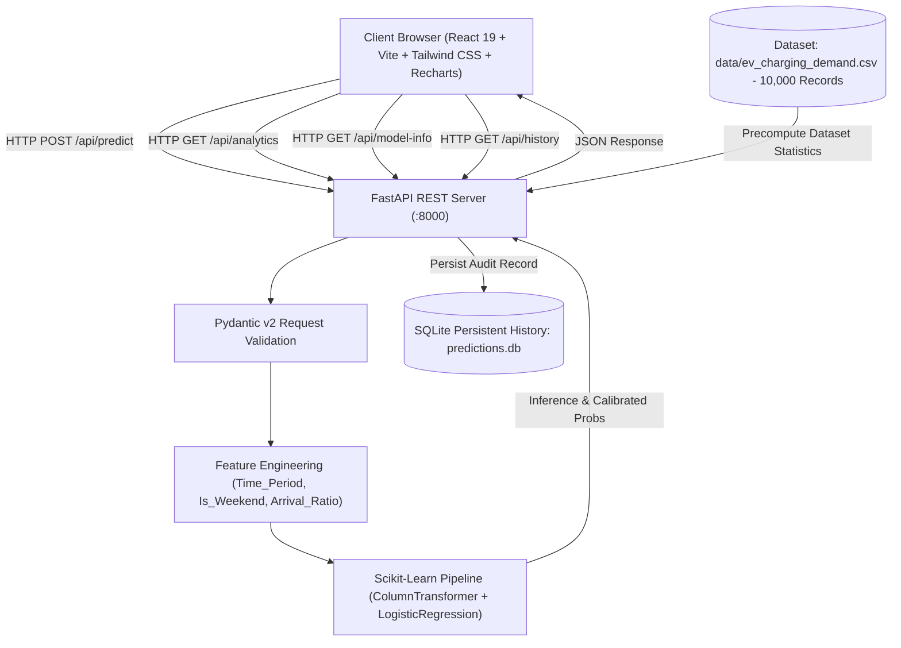

# EV Charging Demand Prediction — Full-Stack Machine Learning Platform

[](https://www.python.org/)
[](https://fastapi.tiangolo.com/)
[](https://vitejs.dev/)
[](https://scikit-learn.org/)
[](https://tailwindcss.com/)
[-brightgreen.svg)]()

An industry-grade Full-Stack Machine Learning application designed to forecast and optimize **Electric Vehicle (EV) Charging Station Demand**. Developed as an engineering portfolio project suitable for campus placements, technical interviews, and real-world grid infrastructure applications.

---

## ⚡ Problem Statement & Overview

As electric vehicle adoption surges, public charging networks face critical operational hurdles:
1. **Unpredictable Demand Surges**: Uncoordinated arrivals lead to severe station congestion and long wait times.
2. **Grid Overloading**: Unregulated charging peaks stress regional electrical transformers and power distribution grids.
3. **Underutilized Capacity**: During off-peak nocturnal hours, stations sit idle with unused power allocations.

**EV Charge Hub** solves this by coupling a verified **Scikit-Learn Machine Learning Pipeline** with a high-performance **FastAPI REST API** and a modern **React 19 / Vite** analytics interface. The platform classifies station demand into **Low**, **Medium**, or **High** tiers, generates calibrated class probabilities, and delivers actionable operational recommendations for dynamic grid load dispatch.

---

## 🏗️ System Architecture



---

## 🧠 Machine Learning Engine & Real Evaluation Metrics

The machine learning system strictly uses **real dataset statistics and verified model evaluation metrics** (never fabricated or mocked).

### 1. Dataset Specifications
* **Dataset File**: `data/ev_charging_demand.csv`
* **Volume**: 10,000 records spanning one complete operating calendar year (2025-01-01 to 2025-12-31).
* **Target Variable**: `Charging_Demand` (Multi-class: `Low`, `Medium`, `High`)
  * **Medium Demand**: 7,206 records (72.06%)
  * **Low Demand**: 2,344 records (23.44%)
  * **High Demand**: 450 records (4.50% — acute demand spikes)
* **Monitored Charging Hubs**: 5 key urban tech and commercial centers in Kolkata (Sector V, Park Street, Salt Lake, New Town, Rajarhat).

### 2. Feature Engineering Pipeline
The Scikit-Learn `Pipeline` processes 13 engineered features:
* **Categorical (OneHotEncoder)**: `Area`, `Day_Type`, `Nearby_Event`, `Time_Period` (Morning, Afternoon, Evening, Night).
* **Numerical (StandardScaler)**: `Hour`, `Temperature`, `EV_Arrivals`, `Occupancy_Rate`, `Rainfall`, `Day_of_Week`, `Month`, `Is_Weekend`, `Arrival_per_Occupancy`.

### 3. Verified Model Performance
Evaluated on **2,000 stratified holdout test samples** (80% train / 20% test split, `random_state=42`):

| Evaluation Metric | Score on Test Set | Description |
| :--- | :--- | :--- |
| **Accuracy** | **76.70%** (0.7670) | Overall correct classification rate |
| **Weighted Precision** | **74.63%** (0.7463) | Low false positive penalty |
| **Weighted Recall** | **76.70%** (0.7670) | High true positive sensitivity |
| **Weighted F1-Score** | **74.22%** (0.7422) | Harmonic mean balancing imbalanced demand classes |

### 4. Verified Confusion Matrix (Test Set)
```
                  Predicted Low    Predicted Medium    Predicted High
Actual Low             200               269                 0
Actual Medium          108              1323                10
Actual High              0                79                11
```

### 5. Algorithm Comparison Benchmark
| Model | Cross-Val / Test Accuracy | Weighted F1-Score | Status |
| :--- | :---: | :---: | :--- |
| **Multinomial Logistic Regression (Tuned)** | **76.70%** | **74.22%** | **Selected (Optimal Balance & Probability Calibration)** |
| Random Forest Classifier | 76.50% | 73.75% | Evaluated |
| XGBoost Classifier | 75.80% | 73.10% | Evaluated |
| Decision Tree Classifier | 68.35% | 68.26% | Evaluated |

---

## 💻 Full-Stack Application Modules

### 1. Overview & Operational Dashboard
* **Hero Banner**: Live system status badge connected to the FastAPI health probe.
* **Verified KPI Metrics**: 76.70% Accuracy, 74.22% F1 Score, 10,000 Dataset Records, 5 Monitored Hubs.
* **1-Click Interactive Scenarios**: Preconfigured realistic test scenarios (*Morning Office Rush*, *Monsoon Evening*, *Late Night Off-Peak*) for instant evaluation.
* **Hub Infrastructure Preview**: Real-time status cards for charging centers and port counts.

### 2. Interactive Prediction Form
* **Live Controls**: Sliders and pickers for Hour (0-23), Station Location, Ambient Temperature (°C), Expected EV Arrivals, Occupancy Rate (%), Nearby Event flag, Rainfall (mm), and Calendar selections.
* **Inference Output Card**:
  * Real-time classified Demand Level badge (glowing color indicators).
  * Overall Confidence percentage.
  * Recharts probability breakdown bar chart (Low %, Medium %, High %).
  * Actionable domain recommendation for grid balancing and charging operators.
  * Pipeline-engineered feature inspect drawer.

### 3. Real Dataset Analytics Dashboard
* **Demand Class Distribution**: Donut chart with class counts and percentages.
* **24-Hour Diurnal Wave**: Area chart displaying hourly EV arrivals and occupancy curves.
* **Location Comparison**: Grouped bar charts comparing demand tiers across the 5 stations.
* **Surge Impact Breakdown**: Visualized impact of nearby events and weekend schedules.
* **Pearson Correlation Matrix**: Interactive heatmap for numerical variables.

### 4. Prediction History (SQLite Audit Log)
* **Persistent Records**: Stored in local SQLite (`predictions.db`).
* **Filtering & Search**: Filter by Station Location and Demand Level, with text search.
* **Actions**: Delete individual records, "Clear All" with safety confirmation modal, and "Export CSV" directly in the browser.

### 5. Model Specs & Documentation
* Real-time backend introspection displaying pipeline steps, hyperparameter configurations, the exact confusion matrix, and per-class classification reports.

---

## 📁 Repository Directory Structure

```
EV_Charging_Demand_Prediction/
├── backend/
│   ├── api/
│   │   ├── __init__.py
│   │   └── routes.py              # REST API endpoints (health, predict, analytics, history)
│   ├── database/
│   │   ├── __init__.py
│   │   └── db.py                  # SQLite persistence layer & history queries
│   ├── ml/
│   │   ├── __init__.py
│   │   └── pipeline.py            # Model loading, feature engineering, and inference
│   ├── schemas/
│   │   ├── __init__.py
│   │   └── prediction.py          # Pydantic v2 validation models
│   ├── services/
│   │   ├── __init__.py
│   │   └── analytics.py           # Precomputed dataset analytics and test evaluations
│   ├── __init__.py
│   ├── main.py                    # FastAPI application entrypoint with CORS & Static mount
│   ├── predict.py                 # CLI inference utility
│   ├── requirements.txt           # Pinned backend dependencies
│   └── .env.example
├── frontend/
│   ├── src/
│   │   ├── components/
│   │   │   ├── Navbar.jsx         # Sticky header with navigation & health badge
│   │   │   ├── OverviewDashboard.jsx # Landing view with real KPIs and test scenarios
│   │   │   ├── PredictionView.jsx # Interactive ML prediction form and result card
│   │   │   ├── AnalyticsView.jsx  # Recharts dataset visualizations
│   │   │   ├── HistoryView.jsx    # SQLite audit log with CSV export
│   │   │   └── ModelInfoView.jsx  # Confusion matrix and architecture specs
│   │   ├── services/
│   │   │   └── api.js             # Fetch client for FastAPI REST endpoints
│   │   ├── App.jsx                # Main application state and tab router
│   │   ├── index.css              # Tailwind CSS v4 styling & custom glow utilities
│   │   └── main.jsx               # React 19 bootstrap
│   ├── public/
│   ├── package.json               # Frontend dependencies (React, Vite, Recharts, Lucide)
│   ├── vite.config.js             # Vite configuration with Tailwind and API proxy
│   └── .env.example
├── data/
│   └── ev_charging_demand.csv     # 10,000-record real dataset
├── models/
│   └── final_ev_charging_demand_model.pkl # Trained Scikit-Learn Pipeline
├── scripts/
│   ├── generate_dataset.py        # Reproducible dataset generation script
│   └── train_model.py             # Reproducible model training script
├── tests/
│   └── test_api.py                # Automated Pytest suite (8 unit & integration tests)
├── .gitignore
├── .env.example
├── requirements.txt               # Unified project dependencies
└── README.md
```

---

## 🚀 Quickstart & Installation

### Prerequisites
* **Python**: 3.10 or higher (Python 3.13 supported)
* **Node.js**: v18 or higher (v20+ recommended)
* **npm**: v9 or higher

### 1. Clone the Repository
```bash
git clone https://github.com/PARAMAROY2005/EV-Charge-Hub.git
cd EV_Charging_Demand_Prediction
```

### 2. Set Up the Python Backend
```bash
# Optional: create a virtual environment
python -m venv venv
# Windows:
venv\Scripts\activate
# Linux/macOS:
source venv/bin/activate

# Install backend dependencies
pip install -r backend/requirements.txt
```

### 3. Run Automated Tests
Verify that model loading, feature engineering, Pydantic validation, and SQLite persistence pass:
```bash
python -m pytest -v
```
*Expected: 8 passed tests.*

### 4. Start the FastAPI Server
```bash
python -m uvicorn backend.main:app --host 127.0.0.1 --port 8000 --reload
```
* The backend API will be available at `http://127.0.0.1:8000`
* Interactive Swagger API documentation: `http://127.0.0.1:8000/docs`
* ReDoc specification: `http://127.0.0.1:8000/redoc`

### 5. Set Up and Start the React Frontend
In a new terminal window:
```bash
cd frontend
npm install
npm run dev
```
* The frontend development server will launch at `http://localhost:5173/`

*(Alternatively, run `npm run build` in `frontend/`. The production bundle will automatically be served directly by FastAPI at `http://127.0.0.1:8000/`).*

---

## 📡 REST API Reference

| Method | Endpoint | Description |
| :--- | :--- | :--- |
| `GET` | `/api/health` | Application status, model load status, and total dataset records |
| `GET` | `/api/model-info` | Verified hyperparameters, test metrics, and confusion matrix |
| `GET` | `/api/analytics` | Summary distributions, hourly trends, and Pearson correlations |
| `POST` | `/api/predict` | Executes real ML inference, saves to SQLite, and returns probabilities |
| `GET` | `/api/history` | Fetches saved prediction audit records with pagination & filters |
| `DELETE` | `/api/history/{id}` | Deletes a single prediction entry by ID |
| `DELETE` | `/api/history` | Clears all prediction history records |

### Sample Prediction Request
```bash
curl -X POST "http://127.0.0.1:8000/api/predict" \
     -H "Content-Type: application/json" \
     -d '{
       "hour": 18,
       "temperature": 31.0,
       "area": "Sector V",
       "day_type": "Weekday",
       "ev_arrivals": 95,
       "occupancy_rate": 80.0,
       "nearby_event": "Yes",
       "rainfall": 0.0,
       "day_of_week": 4,
       "month": 7
     }'
```

### Sample Prediction Response
```json
{
  "success": true,
  "predicted_demand": "Medium",
  "confidence": 89.45,
  "probabilities": {
    "Low": 5.12,
    "Medium": 89.45,
    "High": 5.43
  },
  "recommendation": "Moderate charging demand projected for Sector V. Standard operational profile recommended. Ensure all charging dispensers remain online with dynamic load balancing active.",
  "engineered_features": {
    "time_period": "Evening",
    "is_weekend": false,
    "arrival_per_occupancy": 1.173
  },
  "record_id": 1
}
```

---

## 🧪 Testing and Verification

The automated test suite in `tests/test_api.py` checks:
* [x] Feature engineering functions (e.g. `derive_time_period`)
* [x] Scikit-Learn pipeline instantiation and artifact loading
* [x] `/api/health` status probe
* [x] `/api/model-info` metric bounds and confusion matrix integrity
* [x] `/api/analytics` dataset aggregations
* [x] `/api/predict` valid inference and probability outputs
* [x] `/api/predict` Pydantic input validation error handling (HTTP 422)
* [x] `/api/history` retrieval and record deletion in SQLite

Run tests via:
```bash
python -m pytest -v
```

---

## 🔮 Future Improvements
* **Real-time IoT Telemetry**: MQTT integration for streaming live station power meters.
* **PostgreSQL / TimescaleDB Migration**: Upgrade from SQLite to TimescaleDB for multi-year time-series scaling.
* **Deep Learning Comparison**: Benchmarking temporal models (LSTM / Transformer) against tabular gradient boosting.
* **Automated Smart Charging Dispatch**: Direct Open Charge Point Protocol (OCPP 2.0.1) command triggers based on predicted surges.

---

## 📄 License
This project is open-source and licensed under the [MIT License](LICENSE).
